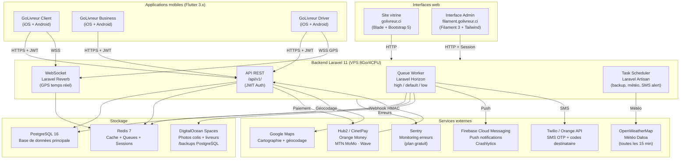

# GoLivreur — Architecture Générale

---

## Vue d'ensemble des composants



---

## Stack technologique détaillée

| Composant | Technologie | Version | Rôle |
|---|---|---|---|
| Applications mobiles | Flutter (Dart) | 3.x | 3 apps (Client, Business, Driver) |
| State management | Riverpod | Dernière | Gestion d'état Flutter |
| Navigation Flutter | go_router | Dernière | Routes + guards par rôle |
| Backend API | Laravel | 11.x | API REST + logique métier |
| Architecture | MVC + Services | — | Contrôleurs fins, Services métier |
| Admin web | Laravel Filament | 3.x | Interface administration |
| Base de données | PostgreSQL | 16 | Données principales |
| Cache / Queues | Redis | 7.x | Cache, files d'attente, sessions |
| WebSocket | Laravel Reverb | 1.x | GPS temps réel, statuts live |
| Supervision queues | Laravel Horizon | Dernière | Dashboard jobs Redis |
| Cartographie | Google Maps | Dernière | Carte + géocodage |
| Push notifications | Firebase FCM | Dernière | Notifications mobiles |
| Crashlytics | Firebase Crashlytics | Dernière | Crash reporting 3 apps |
| SMS | Twilio / Orange API | — | OTP + codes destinataire GoColis |
| Paiement | Hub2 / CinetPay | — | Orange Money, MTN MoMo, Wave |
| Stockage photos | DigitalOcean Spaces | — | Photos colis + backups BDD |
| API Météo | OpenWeatherMap | Dernière | Mode Pluie automatique |
| Documentation API | Scramble | Dernière | OpenAPI 3.0 auto-généré |
| Monitoring erreurs | Sentry | Gratuit | Erreurs production |
| Hébergement | VPS | 8Go RAM / 4CPU | Production + Staging |

---

## Structure des modules Laravel

```
app/
├── Http/
│   ├── Controllers/
│   │   ├── Api/V1/
│   │   │   ├── Auth/           ← Authentification JWT
│   │   │   ├── Client/         ← Endpoints app Client
│   │   │   ├── Merchant/       ← Endpoints app Business
│   │   │   └── Driver/         ← Endpoints app Driver
│   │   └── Web/
│   │       ├── Admin/          ← Filament (auto-généré)
│   │       └── Vitrine/        ← Pages publiques Blade
│   ├── Middleware/
│   │   ├── CityContextMiddleware.php   ← Filtre city_id admins locaux
│   │   ├── SingleSessionMiddleware.php ← Session unique merchant/driver
│   │   └── RoleMiddleware.php          ← Vérification rôle JWT
│   └── Requests/               ← FormRequests par module
├── Modules/
│   ├── GoShop/
│   │   ├── Controllers/
│   │   ├── Services/
│   │   │   ├── OrderService.php
│   │   │   ├── AssignmentService.php   ← Attribution livreur
│   │   │   └── CommissionService.php
│   │   ├── Models/
│   │   └── Routes/
│   └── GoColis/
│       ├── Controllers/
│       ├── Services/
│       │   ├── ParcelService.php
│       │   ├── ParcelCodeService.php   ← Gestion codes expéditeur/destinataire
│       │   └── InsuranceService.php
│       ├── Models/
│       └── Routes/
├── Models/                     ← Modèles partagés (User, City, Wallet...)
├── Services/                   ← Services transversaux
│   ├── WalletService.php
│   ├── NotificationService.php
│   ├── SmsService.php
│   └── WeatherService.php
├── Jobs/                       ← Jobs asynchrones
│   ├── ProcessPaymentWebhook.php  ← Queue: high
│   ├── SendPushNotification.php   ← Queue: default
│   ├── SendSmsOtp.php             ← Queue: default
│   └── UpdateCourierLocation.php  ← Queue: low
└── Policies/                   ← Spatie Permissions + Policies
```

---

## Flux de données — GoShop (commande complète)

```
Client Flutter
    │ POST /api/v1/client/orders
    ▼
OrderController::store()
    │ Valide FormRequest
    │ Appelle OrderService::create()
    ▼
OrderService::create()
    │ Crée order + order_items (unit_price snapshot)
    │ Génère code confirmation (4 chiffres, hashé bcrypt)
    │ Déclenche job AssignMerchantNotification (queue: default)
    ▼
GoLivreur Business (notification FCM)
    │ Commerce accepte (dans les 45s)
    │ POST /api/v1/merchant/orders/{id}/accept
    ▼
OrderService::accept()
    │ Statut → accepted
    │ Déclenche AssignmentService::findNearestDriver()
    ▼
AssignmentService
    │ Trouve livreur le plus proche (disponible, en ligne)
    │ Envoie notification FCM au livreur
    ▼
GoLivreur Driver (accepte dans les 30s)
    │ POST /api/v1/driver/orders/{id}/accept
    ▼
OrderService + WebSocket Reverb
    │ Statut → picked_up → in_transit
    │ GPS mis à jour toutes les 5s (filtre 10m)
    │ Client voit la carte en temps réel
    ▼
Livraison : Driver saisit code client
    │ POST /api/v1/orders/{id}/verify-code
    ▼
OrderService::confirmDelivery()
    │ Statut → delivered
    │ WalletService::creditDriver() (80% frais livraison)
    │ WalletService::creditMerchant() (85% prix produits)
    │ Notification FCM client "Votre commande est livrée !"
    ▼
Client note commerce + livreur
```

---

## Environnements

| Environnement | URL | Infrastructure |
|---|---|---|
| Développement local | localhost:8000 | Docker (PHP + PG + Redis + Nginx) |
| Staging | staging.golivreur.ci | VPS — dossier /var/www/staging |
| Production | golivreur.ci / api.golivreur.ci | VPS — dossier /var/www/production |
| Admin | admin.golivreur.ci | Même VPS, même app Laravel |
