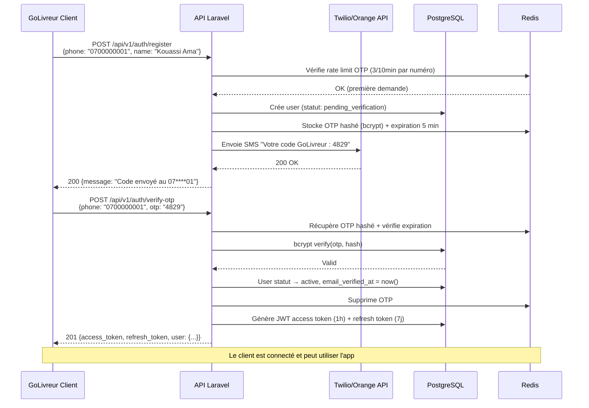
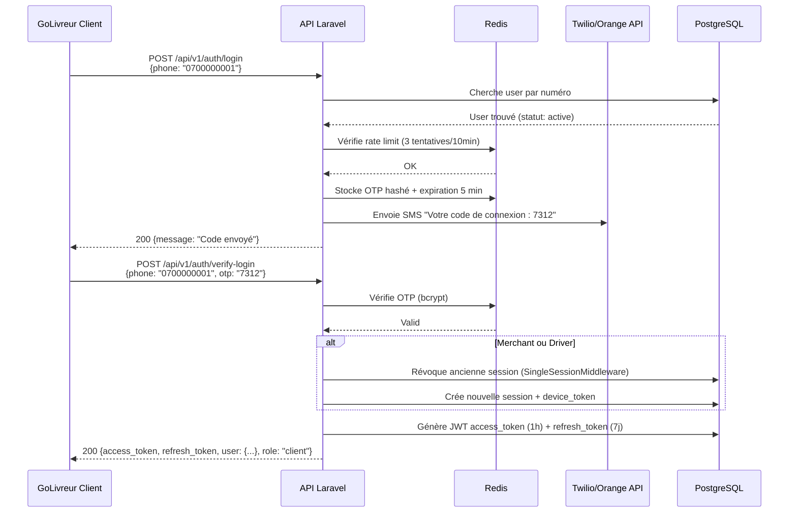
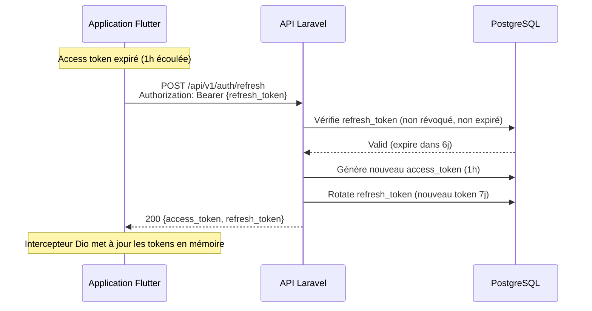
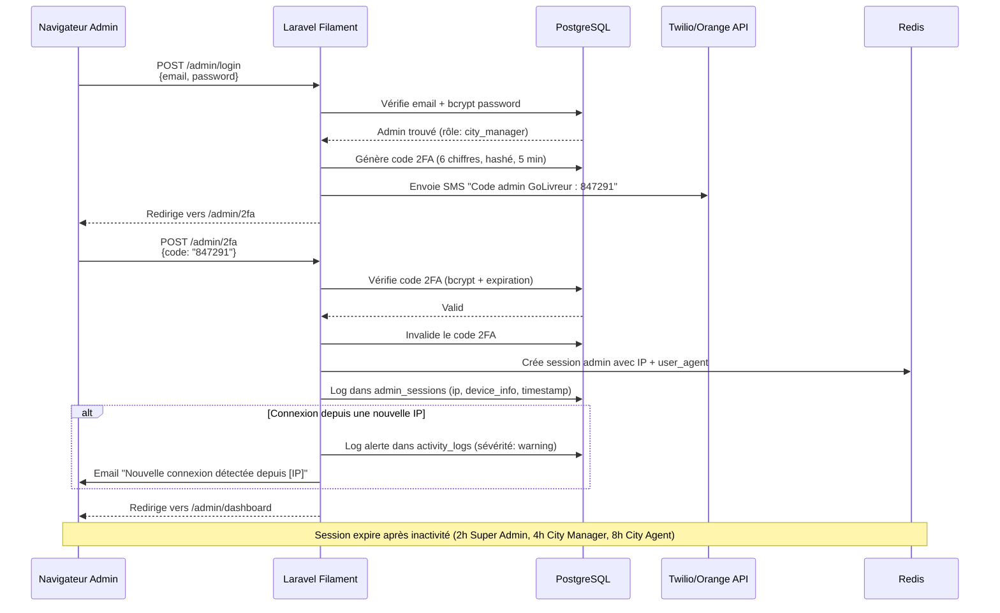
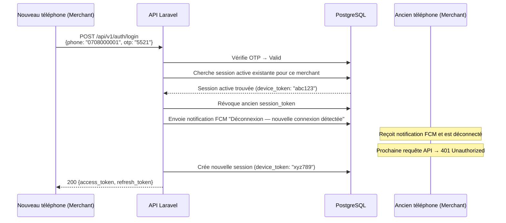

# GoLivreur — Diagrammes de Séquence Authentification

---

## 1. Inscription Client (OTP SMS)

---

## 2. Connexion Client (téléphone + OTP)

---

## 3. Refresh Token JWT

---

## 4. Connexion Admin (email + mot de passe + 2FA)

---

## 5. Déconnexion forcée (Merchant/Driver — session unique)

