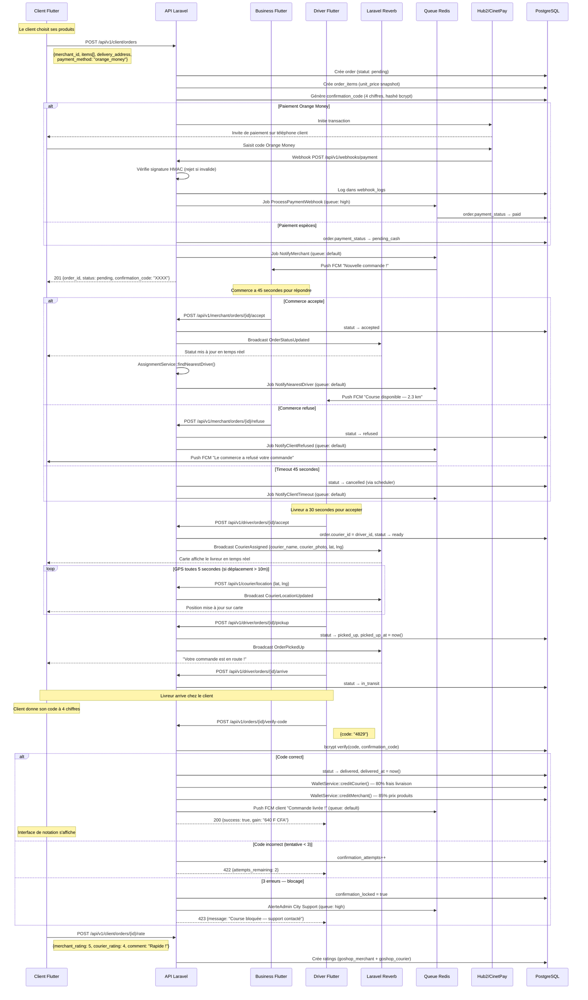
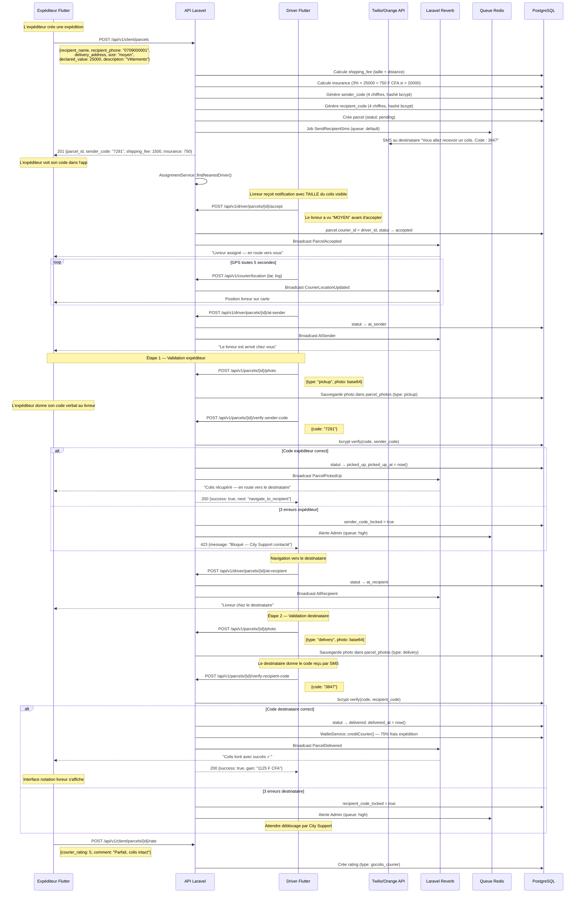
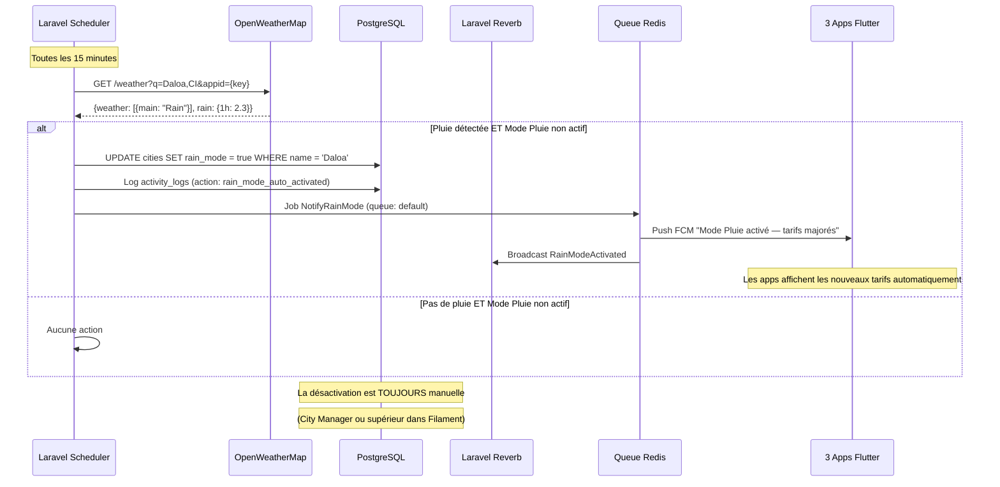

# GoLivreur — Diagrammes de Séquence Métier

---

## 1. Séquence complète GoShop — Commande à la livraison

---

## 2. Séquence complète GoColis — Double code de confirmation

---

## 3. Séquence Mode Pluie — Déclenchement automatique

